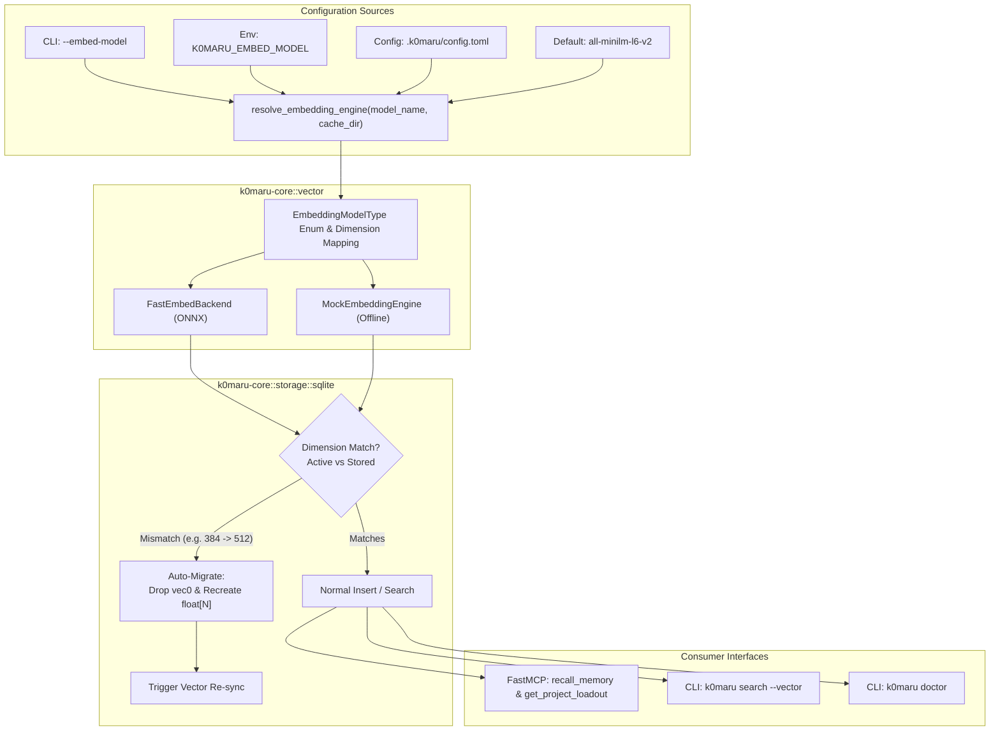

# Specification: Phase 10.1 Pluggable Embeddings Architecture & Multi-Model Engine

## 1. Context & Motivation

In Phase 4, `k0maru` introduced local vector acceleration using `fastembed` (ONNX Runtime) and `sqlite-vec`. While this delivered high-speed hybrid search (BM25 + cosine distance), the implementation hardcoded:
1. Model selection to `EmbeddingModel::AllMiniLML6V2` (384 dimensions);
2. SQLite virtual table schema to `embedding float[384]`;
3. Dimension verification to compile-time constant `VECTOR_DIMENSIONS = 384`.

As the ecosystem scales across diverse languages (Chinese-first SecondBrain vs English code repositories), resource-constrained container environments (offline CI, minimal Docker), and specialized retrieval needs (code-specific vs general semantic), hardcoded 384-dimensional English embeddings become a bottleneck:
- **No Chinese-optimized model**: SecondBrain contains Chinese projects and cards where `all-MiniLM-L6-v2` exhibits lower retrieval quality compared to `bge-small-zh-v1.5`.
- **Hard crash on dimension change**: If any model with non-384 dimensions (e.g. 512d or 768d) is passed, `SqliteStorage` hard-errors with `Embedding dimensions mismatch: expected 384, got N`.
- **Lack of user control**: CLI (`k0maru sync`, `k0maru search`), MCP (`k0maru mcp`), and environment variables provide no way to select models without editing source code.

## 2. Architectural Objectives

1. **Pluggable Model Catalog**:
   - Provide a unified, extensible enum `EmbeddingModelType` mapping canonical string identifiers to underlying `fastembed` models and dimensions.
   - Built-in models:
     - `all-minilm-l6-v2` (384d, default general-purpose)
     - `bge-small-en-v1.5` (384d, high-precision English)
     - `bge-small-zh-v1.5` (512d, Chinese-optimized)
     - `bge-base-en-v1.5` (768d, deep semantic retrieval)
     - `paraphrase-multilingual-minilm-l12-v2` (384d, cross-lingual)
     - `mock` (384d, offline/test fixture, zero download)
2. **Dynamic Dimension Storage & Auto-Migration**:
   - `SqliteStorage` dynamically tracks current vector dimension in `vector_schema_info` or schema metadata.
   - When a user switches to a model with different dimensions, `SqliteStorage` safely wipes the old vector index and recreates `document_vectors USING vec0(id TEXT PRIMARY KEY, embedding float[N] distance_metric=cosine)`, resetting `vector_metadata` so `VectorSyncEngine` re-indexes smoothly without corruption or crashes.
3. **Multi-Source Configuration Hierarchy**:
   - CLI flags: `k0maru sync --vector --embed-model bge-small-zh-v1.5`
   - Environment variable: `K0MARU_EMBED_MODEL=bge-small-zh-v1.5`
   - Config file: `.k0maru/config.toml` (`[embedding] model = "..."`)
   - Graceful fallback: Falls back to `all-minilm-l6-v2`, and if offline/unavailable, falls back to `mock`.
4. **Doctor & Telemetry Transparency**:
   - `k0maru doctor` inspects and reports active model name, dimension, model cache directory, and download health status.

---

## 3. High-Level Architecture Diagram

---

## 4. Work Breakdown (Tracer-bullet Tickets)

- **Ticket 40-1: Embedding Catalog, Enum, and Factory Resolver**
  - Implement `EmbeddingModelType` enum in `crates/k0maru-core/src/vector/models.rs` with `from_str`, canonical aliases, and dimension mappings.
  - Implement `resolve_embedding_engine(model_str: Option<&str>, cache_dir: Option<PathBuf>) -> Result<Arc<dyn EmbeddingEngine>, VectorError>`.
  - Add comprehensive unit tests in `crates/k0maru-core/tests/test_vector_catalog.rs`.

- **Ticket 40-2: Dynamic Dimension Support & Auto-Migration in `SqliteStorage`**
  - Replace static `pub const VECTOR_DIMENSIONS: usize = 384` with dynamic instance dimension management.
  - Add `current_vector_dimension(&self) -> Result<Option<usize>, Box<dyn Error>>`.
  - Add `ensure_vector_dimension(&mut self, target_dim: usize) -> Result<bool, Box<dyn Error>>` that detects dimension changes, drops old `document_vectors` and `vector_metadata`, and creates the new `float[target_dim]` table.
  - Add tests in `crates/k0maru-core/tests/test_dynamic_vector_storage.rs`.

- **Ticket 40-3: CLI Flags, Config/Env Var Resolution & Doctor Integration**
  - Add `--embed-model <MODEL>` flag to `SyncArgs`, `SearchArgs`, and `McpArgs`.
  - Parse `K0MARU_EMBED_MODEL` environment variable.
  - Update `k0maru doctor` to probe the configured embedding model name, dimensions, and report whether weights are cached locally.
  - Add integration tests in `tests/test_embed_cli.rs`.

- **Ticket 40-4: FastMCP Integration & End-to-End Multi-Model Test Suite**
  - Connect configured embedding engine to FastMCP server (`mcp/server.rs`).
  - Add end-to-end integration tests verifying model switching, Chinese-specific retrieval accuracy on mock vault, and dimension migration resilience.
  - Ensure zero clippy warnings and 100% test pass.
