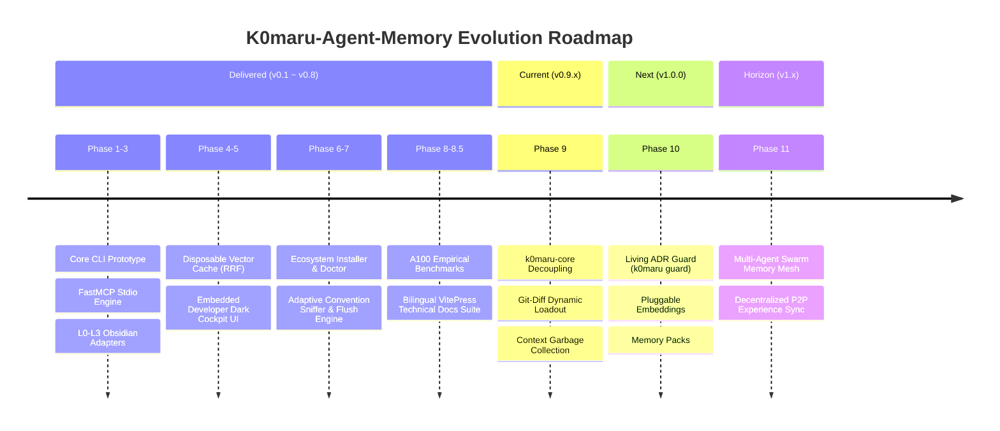

# 🗺️ K0maru-Agent-Memory: Strategic Architecture & Phased Roadmap

> **Niche Focus**: A Standalone, Single-Static-Binary, Zero-Daemon Long-Term Memory & Context Metabolism Hub for AI Coding Agents.

---

## 🏛️ Strategic Moat & Core Architectural Invariants

Unlike generic cloud RAG platforms, enterprise vector microservices, or heavy containerized agent memory stacks, `K0maru-Agent-Memory` maintains strict adherence to four non-negotiable architectural invariants:

1. **Zero-Daemon & Extreme Cold Start (<5ms)**:
   - Delivered as a single, self-contained static binary (<10MB);
   - Zero background services, zero daemon processes, zero network port consumption (`stdio` and CLI execution only);
   - Cold-start latency strictly kept under 5ms (empirically 3.4ms).
2. **Bring Your Own Markdown (BYOM)**:
   - Standard plain-text Markdown is the single source of truth (Obsidian SecondBrain, Karpathy LLM-Wiki, Git docs);
   - Local SQLite cache (`cache.sqlite`) is 100% disposable and rebuildable from raw Markdown in milliseconds.
3. **Decoupled, Portable, and General**:
   - Agnostic to agent runtimes: seamlessly mounts into Claude Code, Cursor, Windsurf, Gemini CLI, Cline, and Hermes Agent;
   - Pure POSIX/Unix pipe-friendly standard streams;
   - Core domain logic cleanly abstracted as an embeddable Rust crate.
4. **Context Hygiene & Token Metabolism**:
   - Sub-300-token rapid project loadout (`k0maru loadout`);
   - 99.44% symbolic log compression via Mermaid state machine offloading (`k0maru offload`);
   - Long-trajectory context pruning to keep LLMs within their cognitive Smart-Zone (15%–60%).

---

## 🚀 Phased Evolution Roadmap

---

### 📦 Completed Milestones (v0.1.0 – v0.8.2)

- [x] **Phase 1: Dogfooding Prototype**: Prototyped memory loadout and Mermaid log offloading inside Obsidian SecondBrain.
- [x] **Phase 2: Rust 2021 Core & CLI**: Re-implemented as a high-performance single static binary (3.66MB, 3.4ms cold start).
- [x] **Phase 3: FastMCP Stdio Protocol**: Native Model Context Protocol over stdio with natural language intent mapping.
- [x] **Phase 4: Disposable Vector Cache & RRF Hybrid Search**: C-native `sqlite-vec` + local ONNX FastEmbed + RRF ($k=60$) + 1-hop WikiLinks Graph Boost (+0.05).
- [x] **Phase 5: Embedded Developer WebUI Cockpit**: Axum + `rust-embed` zero-daemon visual debugger with dark theme and bilingual i18n.
- [x] **Phase 6: Ecosystem Installer & Health Diagnostics**: `k0maru install` for 5 major agent clients with non-destructive JSON merges; `k0maru doctor` multi-probe system health report.
- [x] **Phase 7: Adaptive Convention Sniffer & Experience Crystallization**: `ConventionSniffer` auto-detecting vault topologies; `FlushEngine` atomic collision-safe note persistence.
- [x] **Phase 8: NVIDIA A100-SXM4-80GB Empirical Benchmarks**: Validated on Qwen3.8-27B, DeepSeek-R1-32B, and DeepSeek-Coder-V2 (100% Pass@1, 5.9x latency boost, 23.2% token savings).
- [x] **Phase 8.5: Bilingual VitePress Documentation Suite**: Production-grade technical manual covering 11 chapters across Chinese and English with GitHub Pages deployment.

---

### 🔄 Phase 9: Core Decoupling & Context Metabolism (`v0.9.x` — In Progress)

- [ ] **Decoupled `k0maru-core` Library Crate**:
  - Extract domain models, Markdown AST parsing, BM25 indexing, vector traits, and graph traversal into an independent, zero-CLI-dependency `k0maru-core` crate;
  - Enable direct Rust-level embedding in third-party agent frameworks, desktop GUIs (Tauri), and terminal multiplexers (Herdr).
- [ ] **Git-Diff Dynamic Context Loadout**:
  - Upgrade `k0maru loadout` and `get_project_loadout` with `--diff` / `--branch` inspection;
  - Inspect Git index/staging tree to dynamically identify touched modules and wake only the relevant Architectural Decision Records (ADRs) while strictly bounding total tokens to `<300`.
- [ ] **Context Garbage Collection & Pruning Protocol**:
  - Implement a session-level context GC for long-running trajectories (50+ turns);
  - Compact repetitive compiler stack traces, fold verbose historical tool-call outputs into symbolic references, and maintain LLM context within the optimal Smart-Zone (15%–60%).
- [ ] **POSIX / Unix Pipe & Stream Standardization**:
  - Standardize stdin/stdout streaming across all subcommands (`git diff | k0maru offload`, `git log | k0maru search`);
  - Provide structured `--json-stream` output and POSIX standard exit codes for automated agent shell pipelines.

---

### 🛡️ Phase 10: Living ADR Guard & Pluggable Engines (`v1.0.0` — Planned)

- [ ] **Living ADR Architecture Guard (`k0maru guard`)**:
  - Transform L3 evergreen rules and crystallized ADRs from the Markdown vault into sub-10ms static AST checks;
  - Mount as a Git pre-commit hook and CI gate to block architectural regressions (e.g. bypassing distributed locks, leaking domain abstractions, or violating state machine idempotency).
- [ ] **Pluggable & Portable Embedding Engines**:
  - Trait-driven abstraction over embedding models;
  - Default lightweight zero-dependency CPU model (`all-MiniLM-L6-v2`);
  - Feature-gated support for Google `EmbeddingGemma 2` and code-specialized embedding models without requiring full recompilation.
- [ ] **LLM-Wiki Memory Packs / Bundles**:
  - Export and import modular, domain-specific Markdown rule packs (e.g. `rust-tokio-pack`, `redis-lock-pack`, `k8s-operator-pack`);
  - Enable zero-friction knowledge sharing across organizations and engineering teams.
- [ ] **v1.0.0 Stability & Release Gate**:
  - Semantic Versioning 1.0.0 API freeze and stability contract;
  - Multi-platform precompiled binary signing and distribution.

---

### 🌐 Phase 11: Swarm Memory Mesh (`v1.x` — Long-Term Horizon)

- [ ] **Multi-Agent Memory Coordination**:
  - Conflict-free collaborative knowledge updates via CRDTs or Git-backed merge flows;
  - Memory synchronization across distributed agent fleets.
- [ ] **Decentralized P2P Experience Exchange**:
  - Peer-to-peer sharing of verified debugging postmortems and architectural solutions.
