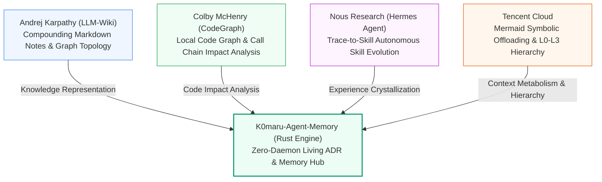
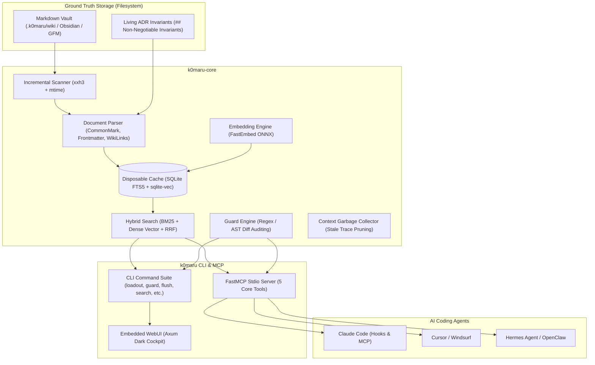

# K0maru-Agent-Memory: Technical Architecture Specification (v1.0.0)

> **Mission**: An independent, lightweight, single-binary agent memory hub and Living ADR guard engine. It provides zero-daemon contextual intelligence, sub-300-token project loadouts, sub-10ms deterministic invariant enforcement, and seamless compatibility with any local Markdown wiki or repository.

---

## 1. Problem Statement & Strategic Positioning

### 1.1 Industry Challenges
- **Heavy Enterprise Microservices**: Systems like Mem0, Letta, or cloud vector platforms impose massive runtime footprints (PostgreSQL, pgvector, Docker containers, multi-port background services) and proprietary data formats that disconnect developers from their raw notes.
- **Passive Chat Dumps & Belief Entrenchment**: Most agent memory tools indiscriminately log raw conversation transcripts. Over time, obsolete discussions and abandoned decisions poison the context window, causing catastrophic model hallucinations and belief entrenchment.
- **Context Exhaustion**: Massive compiler logs, stack traces, and verbose test outputs quickly flood the LLM context window, pushing agents outside their optimal cognitive Smart-Zone (15% to 60%).

### 1.2 The K0maru Positioning: Bring Your Own Markdown (BYOM)
- **Zero-Vault Bootstrap & BYOM**: Operates seamlessly out of the box. Users can bootstrap an instant local wiki (`k0maru init --install`) in 30 seconds or mount an existing Obsidian or Karpathy-style Markdown vault (`k0maru install --vault <path>`).
- **Truth in Files, Performance in Cache**: Human-readable Markdown files remain the sole ground truth. The local SQLite database (`cache.sqlite`) is 100% disposable and automatically regenerates in milliseconds.
- **Zero-Daemon Execution**: Single static binary in pure Rust (3.6 MB pure-Rust core / 33 MB default with bundled ONNX Runtime). Zero background daemons, zero resident services, and zero network port exposure. All interactions run via standard CLI pipes and FastMCP stdio.
- **Active Architectural Governance**: Bridges the gap between static documentation and active execution by turning Architecture Decision Records (ADRs) into deterministic, sub-10ms Git pre-commit and Claude Code Stop-hook guardrails.

---

## 2. Upstream Inspirations & Clean-Room Rust Architecture

`K0maru-Agent-Memory` stands on the shoulders of open-source pioneers, synthesized into an idiomatic, clean-room Rust implementation:

1. **Knowledge Representation (Andrej Karpathy LLM-Wiki)**:
   - Structured, incremental Markdown pages linked via explicit bidirectional WikiLinks (`[[Note]]`).
   - Plain text as the long-term, cross-generational medium of truth.
2. **Code Intelligence (Colby McHenry CodeGraph)**:
   - High-performance Rust-native AST parsing and call-graph awareness.
   - Clean orchestration interfaces without bloated external dependencies.
3. **Skill Evolution (Nous Research Hermes Agent)**:
   - Dynamic skill definitions capturing execution traces, trigger conditions, and verification playbooks.
   - Native Hermes skill schema export (`k0maru distill --target hermes`).
4. **Context Metabolism (Tencent Cloud)**:
   - L0–L3 epistemic lifecycle hierarchy (L0 Daily, L1 Resource, L2 Log, L3 Evergreen/ADR).
   - Symbolic log offloading replacing verbose terminal traces with compact Mermaid state machines.

---

## 3. Subsystem Architecture

The system is organized into a modular workspace consisting of `k0maru-core` (the reusable domain engine) and `k0maru` (the CLI and MCP binary interface):

### 3.1 `k0maru-core` Subsystems
- **`adapters`**: Modular readers parsing directory topologies across flat LLM-Wikis, Obsidian vaults, and nested engineering documentation folders.
- **`parser`**: Fast streaming Markdown parser extracting YAML frontmatter, WikiLinks (`[[target]]` and `[[target|alias]]`), headers, and invariant blocks (`- [id] (severity) [glob] condition: "..."`).
- **`scanner`**: Non-blocking filesystem crawler using `xxh3` hashing and file modification times (`mtime`) to compute differential updates (`added`, `modified`, `deleted`) in sub-10ms.
- **`storage`**: Embedded SQLite abstraction managing transactional operations, connection pooling, FTS5 inverted BM25 indices, and automated zero-migration self-healing.
- **`vector`**: Local ONNX Runtime embedding integration (`all-MiniLM-L6-v2`) generating 384-dimensional dense vectors on CPU with dynamic dimension storage in `sqlite-vec`.
- **`guard`**: Deterministic invariant engine executing AST substring, word-boundary, and regex checks on git diff hunks across staged, unstaged, or commit ranges (<10ms).
- **`gc`**: Context lifecycle management pruning ephemeral terminal offload logs and maintaining optimal cache density.

### 3.2 `k0maru` Binary & Interface Subsystems
- **`bootstrap` (`init`)**: One-command repository bootstrapper generating `.k0maru/wiki`, seed Living ADRs, lifecycle hooks, and client configurations from project metadata.
- **`loadout`**: Context assembler compiling project vision, diff-triggered ADR invariants, and recent engineering logs into a `< 300 token` payload.
- **`flush`**: Atomic write-back engine persisting decisions, notes, and playbooks with automated naming conflict avoidance and supersession decay handling.
- **`distill`**: Heuristic trace analyzer converting raw compilation errors and test stack traces into structured troubleshooting skills.
- **`pack`**: Archival and sharing utility exporting and importing self-contained `.pack.json` memory bundles with automated topology adaptation.
- **`ui`**: Zero-daemon local web console powered by Axum and `rust-embed`, visualizing multi-modal search attribution, log state machines, and token ROI.
- **`mcp`**: High-performance stdio server implementing the Model Context Protocol:
  - `get_project_loadout`
  - `recall_memory`
  - `guard_check`
  - `flush_session`
  - `distill_session_skill`

---

## 4. Data Flow & Execution Lifecycles

### 4.1 Session Initiation Lifecycle (Sub-300 Token Loadout)
1. The AI coding assistant starts a session, triggering `hooks.SessionStart` or invoking `get_project_loadout({ "diff": true })`.
2. `IncrementalScanner` inspects git status and uncommitted diffs.
3. `LoadoutBuilder` matches diff paths against active Living ADR glob scopes.
4. Active invariants, project identity, and recent milestones are assembled into a compact `<300 token` markdown block and injected into the prompt.

### 4.2 Guard & Pre-Commit Lifecycle (Sub-10ms Deterministic Enforcement)
1. Agent finishes code edits and prepares to yield or commit.
2. The agent client or `.git/hooks/pre-commit` invokes `k0maru guard check --diff`.
3. `GuardEngine` parses unified git diff hunks into added and deleted lines.
4. Checks each modified file against active rules:
   - `forbidden`: Diff added lines must not match forbidden patterns.
   - `must_contain`: Modified files matching scope must contain required patterns.
5. If violations exist:
   - Returns exit code 2 (for Claude Code Stop-hook interception) or exit code 1 (blocking git pre-commit).
   - Emits structured error block with exact violation location and remediation hint.
6. If clean: Returns exit code 0 (`✅ Ready to commit`).

### 4.3 Supersession & Memory Decay Lifecycle
1. When an architectural invariant is deprecated or replaced, the agent calls `k0maru flush --supersedes <old-adr>`.
2. `FlushEngine` updates the old ADR's YAML frontmatter:
   - `status: superseded`
   - `superseded_by: [[New-ADR]]`
3. The new ADR is written with `status: active` and new invariant definitions.
4. `HybridSearchEngine` and `LoadoutBuilder` follow transitive supersession chains (up to 16 hops):
   - Superseded ADRs receive a $0.2\times$ BM25 penalty and $0.0$ graph boost.
   - Superseded invariants are automatically deactivated, eliminating belief entrenchment.

---

## 5. Licensing, Attribution & Compliance Matrix

`K0maru-Agent-Memory` is released under the **MIT License**. All upstream concepts and libraries have been audited for intellectual property compliance:

| Upstream Asset | Author / Entity | Original License | Integration Model | Compliance Strategy |
| :--- | :--- | :---: | :--- | :--- |
| **LLM-Wiki Pattern** | Andrej Karpathy | Conceptual Design | Clean-room architectural paradigm | Explicit academic & conceptual attribution in docs |
| **CodeGraph** | Colby McHenry | MIT License | External CLI / Protocol integration | Attribution retained; zero proprietary code copies |
| **Hermes Agent** | Nous Research | MIT License | Dynamic skill schema compatibility | Attribution retained; aligned schema definitions |
| **Tencent Cloud** | Tencent Cloud | MIT License | Conceptual paradigm (Offloading / L0-L3) | Clean-room Rust implementation; zero code copying |
| **sqlite-vec** | Alex Garcia | Apache-2.0 | Embedded C library dependency | Permissive license; NOTICE file included |

### Compliance Guarantees:
1. **Clean-Room Rust Implementation**: All parsers, AST traversals, search fusions, and CLI/MCP protocols are authored from scratch in Rust 2021.
2. **Zero Strong Copyleft**: No GPL, AGPL, or SSPL licensed dependencies exist in the dependency tree.
3. **Trademark Neutrality**: K0maru is an independent open-source project and makes no commercial claim to third-party trademarks.
