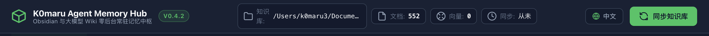
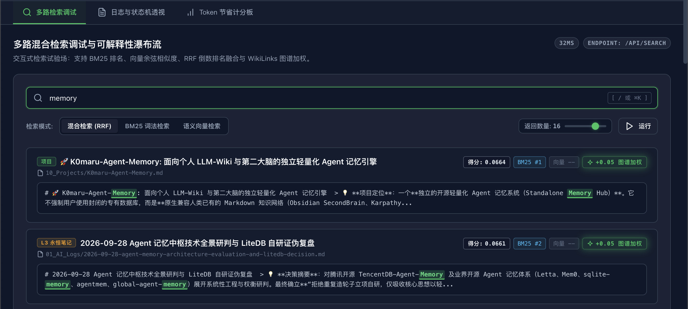
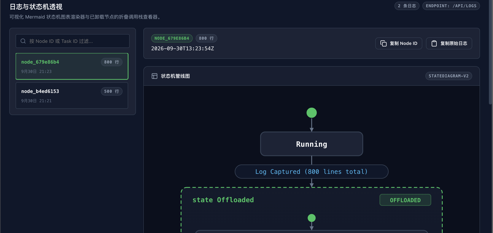
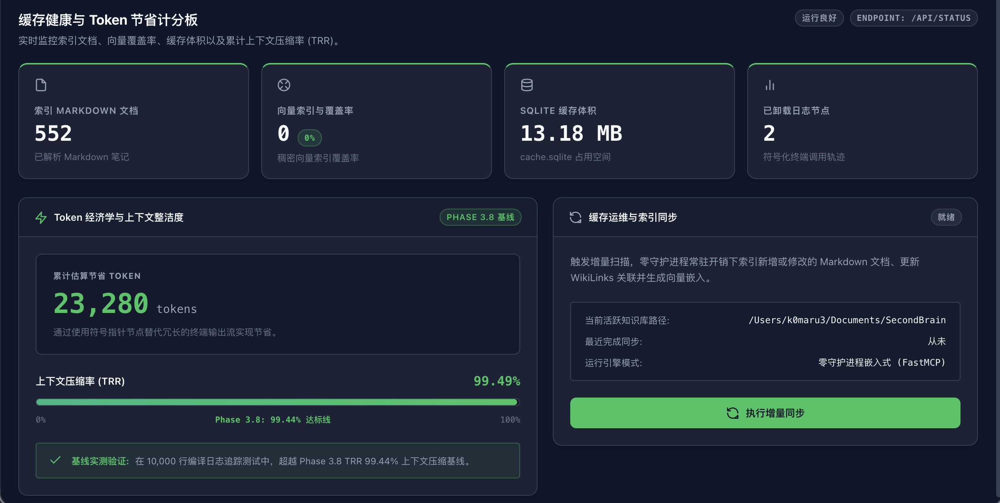

# K0maru Developer Console (UI) User Guide

> **Embedded Local Visual Debugging Dashboard & Context Governance Center for AI Coding Agents**  
> *Zero-Daemon, Single-Binary Developer Dashboard for Obsidian & LLM-Wiki.*

---

## Table of Contents

1. [Design Philosophy & Core Value](#1-design-philosophy--core-value)
2. [Quickstart & CLI Parameters](#2-quickstart--cli-parameters)
3. [Header Status Monitoring & Global Actions](#3-header-status-monitoring--global-actions)
4. [Panel 1: Multi-Modal Search Debugger](#4-panel-1-multi-modal-search-debugger)
5. [Panel 2: Long Log & State Machine Inspector](#5-panel-2-long-log--state-machine-inspector)
6. [Panel 3: Token Economics & Cache Scoreboard](#6-panel-3-token-economics--cache-scoreboard)
7. [Standard Human-in-the-Loop Workflows](#7-standard-human-in-the-loop-workflows)
8. [Lifecycle & Graceful Shutdown](#8-lifecycle--graceful-shutdown)

---

## 1. Design Philosophy & Core Value

When AI coding agents interact with knowledge bases via FastMCP, memory retrieval, relevance scoring, and log truncation traditionally operate inside a black box. Human developers cannot easily evaluate:
- **Retrieval Quality**: Why did the agent select Note A over Note B?
- **Algorithmic Attribution**: What individual contributions were made by BM25 lexical search, dense ONNX embeddings, and WikiLinks graph topology?
- **Execution Failure Context**: When an agent truncates a failing test log, what does the distilled state machine look like, and how can a developer quickly intervene?
- **Quantifiable Cost Reduction**: Exactly how many tokens and API dollars did context governance save?

`k0maru ui` visualizes these critical metrics in a sleek **Developer Dark Console**, strictly upholding our architectural invariants:
- **Zero-Daemon**: Never runs as a background service. It launches on demand and completely releases memory and port bindings upon `Ctrl+C`.
- **Single-Static-Binary**: Frontend static assets are embedded at compile time via `rust-embed`. No Node.js, npm, or Python runtime required.
- **100% Offline Self-Contained (Zero-CDN)**: Operates without external CDNs, running smoothly in air-gapped or sandboxed environments.

---

## 2. Quickstart & CLI Parameters

### Basic Launch
Run directly in your terminal:

```bash
# Mount the local Markdown vault and automatically open the default browser
k0maru ui --vault ~/Documents/MyVault --open
```

Console output:
```text
🚀 K0maru Dashboard active on http://127.0.0.1:3721
Opening http://127.0.0.1:3721 in default browser...
```

### CLI Flags & Options

| Option | Flag | Default | Description |
| :--- | :--- | :--- | :--- |
| `--vault <PATH>` | `-v` | Current working directory | Path to the local Markdown vault (e.g. Obsidian Vault or LLM-Wiki) |
| `--port <PORT>` | `-p` | `3721` | HTTP port to bind (strictly bound to `127.0.0.1` loopback for security) |
| `--open` | None | `false` | Automatically opens the web dashboard in the system default browser |
| `--help` | `-h` | None | Prints command help and options |

---

## 3. Header Status Monitoring & Global Actions

The top header serves as the central control bar for real-time status monitoring and quick actions:


*Figure 1: Header status bar (Vault mount path, document counts, bilingual toggle, and one-click incremental sync)*

### 3.1 Mount Status Badges
- **Vault Path**: Displays the absolute physical path of the mounted Markdown vault.
- **Docs Count**: Total number of indexed Markdown documents stored in SQLite cache.
- **Vectors Count**: Total number of documents with generated 384-dimensional dense embeddings.
- **Synced Timestamp**: Last recorded incremental scan timestamp (e.g., `15:42:10`).

### 3.2 🌐 Bilingual I18n Toggle
- Click the **`🌐 中文 / EN`** pill button in the top right to instantly switch UI text, status cards, tooltips, and toast notifications between English and Chinese.
- **Zero page reload required**.
- **Local Persistence**: User preference is stored in browser `localStorage`, defaulting to your operating system or browser locale on first launch.

### 3.3 ⚡ One-Click Incremental Sync (Sync Vault)
- After adding or modifying notes in your Markdown vault, click **"Sync Vault"**.
- K0maru triggers an incremental `xxh3` hash comparison in the background, updating only modified documents and vectors, and presents a live toast summary.

---

## 4. Panel 1: Multi-Modal Search Debugger

Used to **verify, tune, and evaluate AI agent long-term memory retrieval accuracy**.


*Figure 2: Search Debugger (Query input, hybrid RRF scoring waterfall, and green graph boost badge)*

### 4.1 Global Hotkey
Press **`/`** or **`Cmd+K`** / **`Ctrl+K`** anywhere on the dashboard to focus the search bar. Press **`Esc`** to dismiss.

### 4.2 Tri-Modal Retrieval Strategies
- **Hybrid RRF (Default & Recommended)**:
  Uses Reciprocal Rank Fusion ($k=60$) combining BM25 lexical ranking and dense vector cosine distance. Delivers exceptional recall across both exact technical terms and fuzzy semantic concepts.
- **Lexical BM25**:
  Pure SQLite FTS5 inverted index search, providing deterministic exact matching for function names, error codes, and configuration flags.
- **Vector Dense**:
  Pure 384-dimensional cosine distance retrieval powered by local CPU ONNX (`fastembed-rs`), optimized for conceptual reasoning and natural language queries.

### 4.3 Explainability Waterfall
Each retrieved card displays fine-grained attribution metrics:
- **RRF Score**: Combined fusion score determining final ranking order.
- **BM25 Rank**: Lexical search rank position.
- **Vector Rank**: Dense vector semantic similarity rank position.
- **✨ `+0.05 Graph Boost` Green Badge**:
  When a candidate note shares bidirectional WikiLinks (`[[OtherNote]]`) with other top candidates, K0maru awards an adjacency graph boost (+0.004 to +0.05). This badge visually verifies that your bidirectional links are actively improving retrieval accuracy.

---

## 5. Panel 2: Long Log & State Machine Inspector

Designed for **troubleshooting long-running task failures, inspecting truncated execution traces, and human intervention**.


*Figure 3: Log Inspector (Offline Mermaid state machine, line numbers, error highlighting, and one-click copy)*

### 5.1 Master-Detail Layout
- **Left Sidebar**: Chronological listing of all truncated log nodes created by `offload_context`, filterable by node ID (e.g., `node_`) or task tag (e.g., `cargo-test`).
- **Right Detail View**: Full structural breakdown of the selected execution trace.

### 5.2 Offline Mermaid State Machine
Renders a visual execution pipeline graph completely offline, immediately indicating at which phase the task encountered an error or was truncated.

### 5.3 Syntax Colorization & Error Pinpointing
- Standard code editor line numbers.
- Automatically highlights lines containing `error`, `failed`, `panicked`, or `exception` in **red background** and warnings in **yellow background**, pinpointing root causes across hundreds of lines of output.

### 5.4 One-Click Collaboration Workflow
- **Copy Node ID**: Copies the reference identifier to clipboard for terminal inspection via `k0maru inspect <node_id>`.
- **Copy Raw Log**: Extracts the full lossless raw stack trace ready to paste into Claude Code or Cursor for guided patching.

---

## 6. Panel 3: Token Economics & Cache Scoreboard

Used to **quantify token savings and monitor underlying memory system health**.


*Figure 4: Cache Health & Scoreboard (Core KPI matrix, TRR context reduction ratio, and sync status)*

### 6.1 Core Asset KPI Matrix
1. **Indexed Documents**: Total valid Markdown notes parsed and cached in SQLite.
2. **Vector Coverage**: Percentage of notes embedded with dense vectors (100% indicates full semantic coverage).
3. **SQLite Cache Size**: Compact disk footprint of the transient `cache.sqlite` database file.
4. **Offloaded Log Nodes**: Number of voluminous terminal traces offloaded out of the agent's active context window.

### 6.2 Token Economics & Quantifiable ROI
- **Cumulative Tokens Saved Counter**:
  Calculated by comparing raw log character volume against distilled state machine overhead:
  $$\text{Tokens Saved} \approx \sum (\text{Raw Lines} \times 18) - \text{Mermaid Graph Overhead}$$
- **Token Reduction Ratio (TRR)**:
  Measures the context compression achieved by log offloading (typically **98.5% to 99.6%**), displayed on a visual gauge.

---

## 7. Standard Human-in-the-Loop Workflows

### Scenario A: Verifying Memory Retrieval for New Notes
1. Create a new architecture card in your vault: `20_Cards/distributed-deadlock-handling.md`.
2. Launch `k0maru ui --open` (or click **"Sync Vault"** in an already open dashboard).
3. In the search panel, press `/` and type: *"how to resolve cross-shard deadlocks"*.
4. Verify that the new note ranks at the top, and inspect its RRF score and `+0.05 Graph Boost` badge. If the graph boost is absent, add `[[RelatedArchitectureCard]]` WikiLinks to strengthen topological associations.

### Scenario B: Rapid Debugging from 500-Line Build Failures
1. The agent executes `cargo test | k0maru offload`, emitting a compact state machine and returning identifier `node_7b810e12`.
2. Open the dashboard and switch to the **Log Inspector** panel.
3. Select `node_7b810e12` in the left sidebar.
4. Inspect the Mermaid graph and the red-highlighted error lines (e.g., assertion failure at line 184).
5. Click **"Copy Raw Log"** and paste it into Claude Code / Cursor: *"Please inspect this assertion failure and propose a fix."*

---

## 8. Lifecycle & Graceful Shutdown

- **Zero Background Daemons**: The dashboard web server runs exclusively during explicit user execution.
- **Graceful Exit**: In the terminal running `k0maru ui`, press:
  ```bash
  ^C
  ```
  Console output:
  ```text
  Shutting down K0maru Dashboard server...
  ```
  The server immediately unbinds port `3721` and frees all memory, leaving zero orphaned processes.
