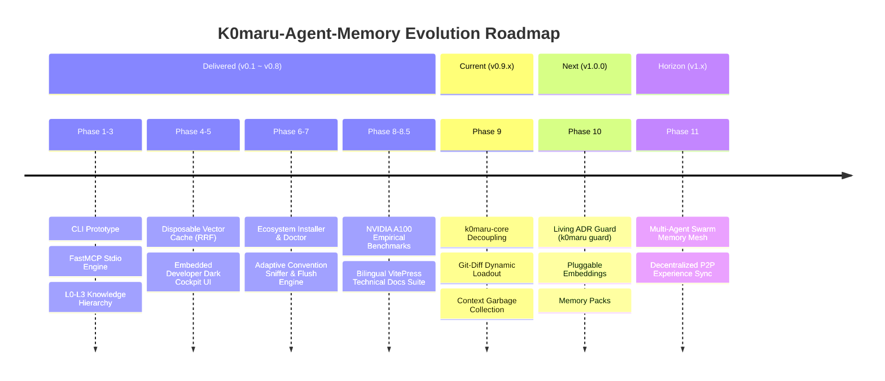

# Roadmap & Architectural Invariants

K0maru-Agent-Memory maintains an uncompromising focus on lightweight, zero-daemon, portable, and white-box memory infrastructure for AI coding agents. This document details the strategic moat, core invariants, and evolutionary roadmap of the project.

---

## 🏛️ Strategic Niche & Architectural Invariants

Unlike generic cloud RAG platforms, enterprise vector databases, or interactive note-taking UIs, K0maru-Agent-Memory is **strictly specialized as a long-term memory and context metabolism hub tailored for AI coding agents**.

The project enforces four non-negotiable architectural invariants:

1. **Single Static Binary & Zero-Daemon Execution**:
   - The compiled binary size is strictly bounded (3.6 MB pure-Rust core with `--no-default-features` / 33 MB default with bundled ONNX Runtime);
   - Cold-start latency remains strictly sub-5ms (empirically 3.4 ms);
   - The engine operates without background daemons, polling loops, or open network ports, relying exclusively on standard `stdio` streams and CLI pipes.
2. **Bring Your Own Markdown (BYOM)**:
   - Plain Markdown notes (Obsidian SecondBrain, Karpathy LLM-Wiki, or Git repositories) remain the single source of truth;
   - The local SQLite database (`cache.sqlite`) serves solely as a disposable transient accelerator that can be deleted at any time and regenerated in milliseconds without data loss.
3. **Decoupled, Portable, and General**:
   - Maintains identical behavior across macOS, Linux, and Windows;
   - Conforms strictly to the FastMCP specification and POSIX standard streams, exposing core domain logic through a decoupled, embeddable Rust library (`k0maru-core`).
4. **Context Hygiene & Token Metabolism**:
   - Project loadout (`k0maru loadout`) injects core invariants within a bounded `< 300 Token` footprint;
   - Symbolic log offloading (`k0maru offload`) reduces verbose compiler output by 99.44% through compact Mermaid state machine diagrams;
   - The system preserves LLM context within the optimal cognitive Smart-Zone (15% to 60%).

---

## 🚀 Phased Evolution Overview

---

## 📦 Delivered Milestones (Phase 1 through Phase 8.5)

- **Phases 1–3 (v0.1.0 – v0.2.0)**: Prototyped Markdown loadout and symbolic log offloading, built the Rust 2021 core, and implemented zero-daemon FastMCP stdio server support.
- **Phase 4 (v0.3.0)**: Integrated C-native `sqlite-vec` with local ONNX FastEmbed, implementing RRF ($k=60$) rank fusion and 1-hop WikiLinks Graph Boost (+0.004, ~25% of top-1 RRF).
- **Phase 5 (v0.4.2)**: Shipped an embedded Developer Dark Cockpit WebUI via Axum and `rust-embed`, featuring query latency telemetry, 2D force graph visualization, and i18n support.
- **Phase 6 (v0.5.0)**: Introduced `k0maru install` for 5 major AI coding agents with non-destructive JSON merges, alongside `k0maru doctor` multi-probe health diagnostics.
- **Phase 7 (v0.6.0)**: Released `ConventionSniffer` for automated vault layout discovery, and `FlushEngine` for atomic collision-safe decision crystallization.
- **Phase 8 (v0.8.0)**: Completed empirical evaluations on Google Colab NVIDIA A100-SXM4-80GB hardware across Qwen2.5-32B-Instruct (100% Pass@1), DeepSeek-R1-32B (-48.2% reflection latency), and DeepSeek-Coder-V2 (1.05s response).
- **Phase 8.5 (v0.8.2)**: Shipped the 11-chapter bilingual VitePress documentation platform and automated GitHub Actions deployment.

---

## 🔄 Phase 9: Core Decoupling & Context Metabolism (`v0.9.x` — In Progress)

As autonomous agents undertake extended, multi-turn coding assignments, context exhaustion and runtime coupling become primary bottlenecks. Phase 9 addresses these challenges directly:

### 1. Decoupled `k0maru-core` Library Crate
- Separate domain models, Markdown AST parsing, BM25 indexing, vector traits, and WikiLinks graph algorithms into an independent Rust crate;
- Ensure zero CLI and zero WebUI dependencies in the core crate;
- Allow third-party desktop tools (e.g. Tauri apps), IDE extensions, or agent supervisors (e.g. Herdr, Codex) to embed K0maru as a native Rust library.

### 2. Git-Diff Dynamic Context Loadout
- Enhance the `k0maru loadout` command and `get_project_loadout` tool with `--diff` and `--branch` inspection modes;
- Examine the Git staging area and working directory to dynamically determine touched modules and awaken only the relevant L3 architectural invariants and ADRs;
- Maintain total context injection strictly below `< 300 Tokens` while moving from static boilerplate injection to change-aware grounding.

### 3. Long-Trajectory Context Garbage Collection & Pruning Protocol
- Implement an automated session context garbage collector for workflows exceeding 50 turns;
- Detect and prune redundant compiler output and large tool-result blocks;
- Compress historical turns into symbolic Mermaid references, keeping agent context within the peak-accuracy Smart-Zone (15% to 60%).

### 4. POSIX / Unix Stream Standardization
- Complete standard stdin/stdout pipeline interoperability across all subcommands (`git diff | k0maru offload`, `git log | k0maru search`);
- Standardize `--json-stream` output and POSIX exit codes for scriptable orchestration.

---

## 🛡️ Phase 10: Living ADR Guard & Pluggable Engines (`v1.0.0` — Planned)

### 1. Living ADR Architecture Guard (`k0maru guard`)
- Convert L3 evergreen rules and crystallized ADRs from the Markdown vault into sub-10ms static analysis checks;
- Support installation as a Git pre-commit hook or CI workflow gate;
- Intercept changes that violate documented architectural invariants (e.g., misconfigured distributed locks, broken domain encapsulation, or missed idempotency checks).

### 2. Pluggable Embedding Architecture
- Decouple embedding engines via Rust traits;
- Provide the default lightweight, zero-dependency CPU model (`all-MiniLM-L6-v2`);
- Add feature-gated support for Google `EmbeddingGemma 2` and code-specific embeddings without requiring manual engine rewrites.

### 3. LLM-Wiki Memory Packs
- Support bundling proven architectural rules and debugging playbooks into portable Markdown packages (e.g. `rust-tokio-pack`, `k8s-operator-pack`, `redis-distributed-lock-pack`);
- Provide streamlined import and export commands (`k0maru pack add <name>`) to facilitate organizational knowledge sharing.

### 4. 1.0.0 Stability & API Freeze
- Finalize the public API contract with Semantic Versioning 1.0.0 guarantees;
- Provide cryptographic signing for multi-platform binary distributions.

---

## 🌐 Phase 11: Swarm Memory Mesh (`v1.x` — Long-Term Horizon)

- **Collaborative Swarm Coordination**: Coordinate simultaneous knowledge updates across multi-agent swarms using CRDTs or Git-backed merge flows;
- **Decentralized P2P Experience Exchange**: Enable peer-to-peer sharing of verified debugging postmortems across isolated development workstations.
