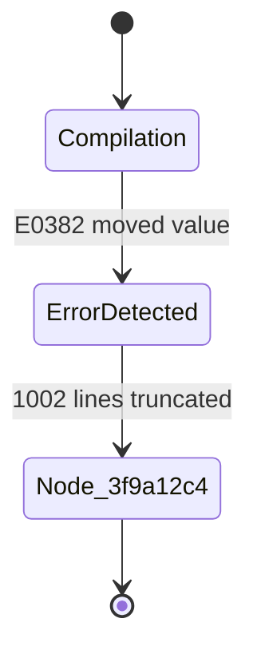

# FastMCP Protocol & Tool Contracts (v1.0.0)

K0maru implements an embedded JSON-RPC 2.0 server adhering to Anthropic's Model Context Protocol (FastMCP) standard. When spawned via `k0maru mcp`, it communicates over standard input/output (`stdio`), operating strictly on demand with 0 persistent background memory footprint and 0 resident daemons.

This manual documents the 8 native MCP tools, JSON Schema contracts, wire protocols, and the orthogonal sidecar execution mode (`--sidecar`).

---

## 🤖 Operating Modes: Full Mode vs. Sidecar Mode

K0maru provides two operational configurations to seamlessly integrate with diverse agent architectures:

| Feature / Tool | Default Full Mode | Orthogonal Sidecar Mode (`--sidecar`) |
| :--- | :---: | :---: |
| **Target Clients** | Claude Code, Cursor, Windsurf, Hermes, OpenClaw, Gemini CLI | Oh My Pi (`omp`) |
| **Total Tools Exposed** | **8 Tools** | **5 Tools** |
| `get_project_loadout` | ✅ Yes | ✅ Yes |
| `recall_memory` | ✅ Yes | ✅ Yes |
| `guard_check` | ✅ Yes | ✅ Yes |
| `flush_session` | ✅ Yes | ✅ Yes |
| `distill_session_skill` | ✅ Yes | ✅ Yes |
| `offload_context` | ✅ Yes | ❌ Omitted (native to `omp`) |
| `inspect_log_node` | ✅ Yes | ❌ Omitted (native to `omp`) |
| `gc_session_context` | ✅ Yes | ❌ Omitted (native to `omp`) |

> **Why Sidecar Mode for `omp`?**  
> Oh My Pi (`omp`) provides its own first-class Unix pipe offloader and multi-turn session compactor. Running `k0maru mcp --sidecar` prevents competing tool signatures while providing deep domain knowledge retrieval, decision crystallization, and sub-10ms Living ADR architectural guardrails.

---

## 🛠️ Tool Quick Reference

| Native Tool Name | Available In | Core Responsibility | Typical Scenario |
| :--- | :--- | :--- | :--- |
| [`get_project_loadout`](#1-get-project-loadout) | Full & Sidecar | Extract project vision & L3 invariants (<300 tokens) | Session bootstrap and background alignment |
| [`recall_memory`](#2-recall-memory) | Full & Sidecar | Multi-channel hybrid search (BM25 + vector + graph) | Technical research & architectural lookups |
| [`guard_check`](#3-guard-check) | Full & Sidecar | Audit Git diff against Living ADR rules (<10ms) | Pre-commit validation & code modification checks |
| [`flush_session`](#4-flush-session) | Full & Sidecar | Crystallize decisions & fixes into Markdown notes | Task milestone completion & decision recording |
| [`distill_session_skill`](#5-distill-session-skill) | Full & Sidecar | Synthesize troubleshooting playbooks from traces | Postmortem analysis & automated skill export |
| [`offload_context`](#6-offload-context) | Full Only | Offload long terminal logs into Mermaid state diagram | Intercepting compiler dumps & test crashes |
| [`inspect_log_node`](#7-inspect-log-node) | Full Only | Retrieve untruncated raw log slices by Node ID | Deep debugging of specific stack frames |
| [`gc_session_context`](#8-gc-session-context) | Full Only | 4-tier session Context Garbage Collection (TRR $\ge 85\%$) | Compacting long multi-turn trajectories |

---

## 1. `get_project_loadout`
*Available in: Full Mode & Sidecar Mode*

### Description
Fetches the project vision, core technology stack, and active L3 Living ADR invariants, strictly bounded to `< 300 tokens`. Supports change-aware diff inspection to dynamically activate module-relevant rules.

### JSON Schema Contract
```json
{
  "name": "get_project_loadout",
  "description": "Fetch high-priority architectural blueprint, core invariants, project vision, and recent ADR decision logs (<300 tokens) from the vault. Always call this at the start of any new coding session or before planning major changes. Supports change-aware diff inspection to dynamically activate module-relevant ADRs.",
  "inputSchema": {
    "type": "object",
    "properties": {
      "project_name": {
        "type": "string",
        "description": "Optional target project name or keyword. Auto-detected from repository/vault when omitted."
      },
      "diff": {
        "type": "boolean",
        "description": "Inspect Git changes in workspace and dynamically activate module-relevant ADRs (<300 tokens)."
      },
      "branch": {
        "type": "string",
        "description": "Optional base branch for comparison (e.g. 'main', 'dev')."
      }
    }
  }
}
```

### Example Input Payload
```json
{
  "project_name": "payment-gateway",
  "diff": true
}
```

### Return Format (Markdown)
```markdown
# Context Loadout: Payment Gateway Core
- Root: `10_Projects/payment-gateway.md`
- Core Stack: Go 1.22, Redis 7, PostgreSQL 16

## L3 Invariants & Decisions:
- [[adr-001-idempotency]]: Acquire Redis mutex via `SET lock:payment:{event_id} "1" NX EX 30`; verify `STATUS_PENDING` in transaction.

## Recent L2 Logs:
- 2026-10-08: Resolved Stripe Webhook retry storm cascade.
```

---

## 2. `recall_memory`
*Available in: Full Mode & Sidecar Mode*

### Description
Searches the knowledge base using Reciprocal Rank Fusion ($k=60$) combining SQLite FTS5 BM25 lexical search, 384-dimensional dense vectors, and 1-hop WikiLinks graph topology boost (+0.05). By default, returns ultra-dense single-line K-DSL wire entries to conserve agent context tokens, with full markdown output available via `full: true`.

### JSON Schema Contract
```json
{
  "name": "recall_memory",
  "description": "Search and retrieve documentation, technical research reports, project context, past architectural decisions, configurations, setup guides, and notes from the user's local knowledge vault. Always call this tool first whenever the user asks for domain information or past decisions.",
  "inputSchema": {
    "type": "object",
    "properties": {
      "query": {
        "type": "string",
        "description": "Search query keywords or technical question."
      },
      "limit": {
        "type": "integer",
        "description": "Maximum number of results to return (default: 5)."
      },
      "full": {
        "type": "boolean",
        "description": "When true, returns full verbose markdown documents. When false (default), returns compact single-line K-DSL wire format (!μ:<tier>|<path>|score:<score>|links:<in>/<out> § <snippet>)."
      },
      "mode": {
        "type": "string",
        "enum": ["hybrid", "bm25", "vector"],
        "description": "Search mode (default: hybrid)."
      }
    },
    "required": ["query"]
  }
}
```

### Example Input Payload
```json
{
  "query": "Stripe webhook idempotency distributed lock",
  "limit": 3,
  "full": false
}
```

### Return Format (Compact K-DSL Wire Entry)
```text
!μ:L3|20_Cards/adr-001-idempotency.md|score:0.082|links:3/5 § Acquire Redis mutex via SET lock:payment:{id} NX EX 30; verify STATUS_PENDING.
!μ:L2|30_Logs/2026-10-08-stripe-storm.md|score:0.041|links:1/2 § Resolved Stripe webhook retry storm cascading failure.
```

---

## 3. `guard_check`
*Available in: Full Mode & Sidecar Mode*

### Description
Audits a Git diff or code change against active Living ADR invariants discovered across the vault in $<10\text{ ms}$. Invoked before committing code or following major refactorings to ensure zero architectural drift.

### JSON Schema Contract
```json
{
  "name": "guard_check",
  "description": "Audit git diff or code changes against active Living ADR architectural invariants and project rules (<10ms). Always invoke this before committing or after implementing features to ensure mandatory patterns are satisfied.",
  "inputSchema": {
    "type": "object",
    "properties": {
      "diff": {
        "type": "string",
        "description": "Optional git unified diff text to audit. If omitted, automatically inspects working tree changes in current git repository."
      },
      "project_name": {
        "type": "string",
        "description": "Optional target project name to filter ADR invariants for."
      },
      "repo_path": {
        "type": "string",
        "description": "Optional path to the git repository to audit (defaults to current directory)."
      },
      "branch": {
        "type": "string",
        "description": "Optional base branch/revision for comparison (e.g. 'main', 'dev')."
      },
      "strict": {
        "type": "boolean",
        "description": "Treat advisory warnings as blocking failures."
      },
      "files": {
        "type": "array",
        "items": { "type": "string" },
        "description": "Optional explicit file paths to audit instead of a diff."
      }
    }
  }
}
```

### Example Input Payload
```json
{
  "diff": "diff --git a/src/db.rs b/src/db.rs\n+let res = sqlx::query(\"SELECT * FROM users\").fetch_all(&pool).await;",
  "strict": true
}
```

### Return Format (Audit Report)
```text
❌ Living ADR Guard Failure: 1 violation detected (<6ms)
- [ADR-008-QuerySafety] Line 1: 'SELECT * FROM users' violates invariant 'deny: SELECT * FROM'.
  Remediation: Specify explicit columns to prevent schema leaks and unindexed full scans.
  Reference: [[20_Cards/adr-008-sql-best-practices.md]]
```

---

## 4. `flush_session`
*Available in: Full Mode & Sidecar Mode*

### Description
Crystallizes architectural decisions, verified fixes, or milestone lessons into the local Markdown vault. Formats notes with YAML frontmatter, links related cards via `[[WikiLinks]]`, and supports `supersedes` to deterministically invalidate obsolete rules.

### JSON Schema Contract
```json
{
  "name": "flush_session",
  "description": "Crystallize technical decisions, verified bug fixes, architecture decisions (ADRs), or task milestones back into the local Markdown vault as permanent notes.",
  "inputSchema": {
    "type": "object",
    "properties": {
      "title": {
        "type": "string",
        "description": "Title of the decision or log note."
      },
      "content": {
        "type": "string",
        "description": "Detailed Markdown content."
      },
      "summary": {
        "type": "string",
        "description": "Brief one-line summary or executive conclusion."
      },
      "category": {
        "type": "string",
        "description": "Category: 'decision', 'log', 'concept' (alias: 'card'), 'skill', or custom (default: 'log')."
      },
      "tags": {
        "type": "array",
        "items": { "type": "string" },
        "description": "Associated tags (e.g. [\"redis\", \"mutex\"])."
      },
      "related_notes": {
        "type": "array",
        "items": { "type": "string" },
        "description": "Related existing notes to link via WikiLinks."
      },
      "supersedes": {
        "description": "Existing note(s) or ADR(s) that this note supersedes. Automatically marks old notes as status: superseded.",
        "oneOf": [
          { "type": "string" },
          { "type": "array", "items": { "type": "string" } }
        ]
      }
    },
    "required": ["title", "content"]
  }
}
```

### Example Input Payload
```json
{
  "title": "ADR-012: Distributed Redlock Consensus",
  "category": "decision",
  "summary": "Migrated single-instance Redis mutex to Redlock cluster to prevent split-brain during master failover",
  "supersedes": ["ADR-001-Redis-Mutex"],
  "tags": ["redis", "redlock", "consensus"],
  "related_notes": ["payment-gateway"],
  "content": "## Context\nSingle-instance locks fail during Redis master reelection...\n## Invariants\n- deny: acquire_single_redis_mutex"
}
```

---

## 5. `distill_session_skill`
*Available in: Full Mode & Sidecar Mode*

### Description
Distills an execution trace or troubleshooting session into a standardized skill card or playbook, supporting export to Markdown, Nous Research Hermes Agent, or Oh My Pi (`omp`).

### JSON Schema Contract
```json
{
  "name": "distill_session_skill",
  "description": "Distill an execution trace, compilation error, or debugging session into a reusable troubleshooting playbook/skill note and save it to the vault or export to Hermes Agent or omp.",
  "inputSchema": {
    "type": "object",
    "properties": {
      "raw_trace": {
        "type": "string",
        "description": "Raw execution log, error stack trace, or debugging terminal output."
      },
      "node_id": {
        "type": "string",
        "description": "Optional offloaded node ID from offload_context (e.g. node_1a2b3c4d)."
      },
      "title": {
        "type": "string",
        "description": "Optional explicit skill title (auto-inferred if omitted)."
      },
      "context_hint": {
        "type": "string",
        "description": "Optional context hint or explanation describing what happened."
      },
      "category": {
        "type": "string",
        "description": "Target category (defaults to 'skill')."
      },
      "tags": {
        "type": "array",
        "items": { "type": "string" },
        "description": "Optional tags array."
      },
      "related_notes": {
        "type": "array",
        "items": { "type": "string" },
        "description": "Optional related notes or WikiLinks array."
      },
      "dry_run": {
        "type": "boolean",
        "description": "If true, returns preview without writing to vault."
      },
      "target": {
        "type": "string",
        "enum": ["default", "hermes", "omp"],
        "description": "Optional target ecosystem schema: 'default' (vault), 'hermes' (Hermes skill), or 'omp' (omp skill)."
      }
    }
  }
}
```

---

## 6. `offload_context`
*Available in: Full Mode Only*

### Description
Externalizes verbose terminal output, compiler stack traces, or test outputs ($>30$ lines) into an on-disk slice, emitting a structural Mermaid state diagram to prevent context window bloat.

### JSON Schema Contract
```json
{
  "name": "offload_context",
  "description": "Externalize and compress verbose terminal logs, build outputs, test traces, or error dumps (>30 lines) into a compact symbolic Mermaid state diagram on disk.",
  "inputSchema": {
    "type": "object",
    "properties": {
      "raw_text": {
        "type": "string",
        "description": "The raw terminal output or stack trace to compress and store."
      },
      "task_name": {
        "type": "string",
        "description": "Optional task identifier prefix."
      }
    },
    "required": ["raw_text"]
  }
}
```

### Return Format
````markdown


✓ Log offloaded (1002 lines, 99.4% token reduction)
  Reference ID: node_3f9a12c4
  Use 'inspect_log_node' to view raw stack frames.
````

---

## 7. `inspect_log_node`
*Available in: Full Mode Only*

### Description
Retrieves the uncompressed raw log slice associated with a specific Node ID from the offline storage pool.

### JSON Schema Contract
```json
{
  "name": "inspect_log_node",
  "description": "Retrieve and inspect the full offloaded raw terminal log or compiler trace content by its node ID (e.g. node_1a2b3c4d).",
  "inputSchema": {
    "type": "object",
    "properties": {
      "node_id": {
        "type": "string",
        "description": "The symbolic node identifier from the Mermaid state diagram."
      }
    },
    "required": ["node_id"]
  }
}
```

---

## 8. `gc_session_context`
*Available in: Full Mode Only*

### Description
Applies the 4-tier compaction protocol to long multi-turn agent conversation trajectories, pruning verbose tool traces and collapsing compiler outputs into symbolic references to keep context within the cognitive Smart-Zone (15%–60%) with $\text{TRR} \ge 85\%$.

### JSON Schema Contract
```json
{
  "name": "gc_session_context",
  "description": "Perform long-trajectory context garbage collection (Context GC) on a multi-turn agent session trajectory, folding verbose tool outputs and repetitive compiler error dumps into symbolic references to keep context within the cognitive Smart-Zone (15%-60%) with TRR >= 85%.",
  "inputSchema": {
    "type": "object",
    "properties": {
      "trajectory_json": {
        "type": "string",
        "description": "JSON serialized SessionTrajectory containing session_id and turns array."
      },
      "threshold": {
        "type": "integer",
        "description": "Line threshold before tool output is folded (default: 20)."
      },
      "hot_window": {
        "type": "integer",
        "description": "Number of recent turns preserved untouched in hot window (default: 5)."
      },
      "context_window": {
        "type": "integer",
        "description": "Context window size in tokens for Smart-Zone evaluation (default: 128000)."
      }
    },
    "required": ["trajectory_json"]
  }
}
```
