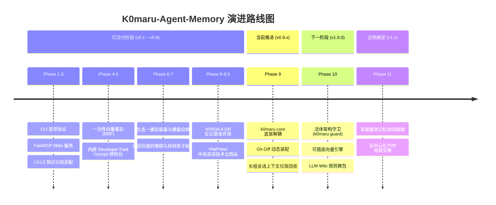

# 演进路线图与未来不变量

K0maru-Agent-Memory 坚持走极致轻量、零常驻、可移植与白盒化的差异化路线。本文档明确了项目的核心护城河、架构不变量以及中长期演进规划。

---

## 🏛️ 细分赛道定位与架构不变量

不同于市面上常见的云端 RAG 平台、重型 Docker 向量微服务或用户端笔记 UI，K0maru-Agent-Memory 始终**锁定在「AI 编码智能体本地原生长期记忆与上下文新陈代谢中枢」这一细分领域**。

我们设立了四大不可妥协的架构不变量（Architectural Invariants）：

1. **单静态二进制与零守护进程（Zero-Daemon）**：
   - 体积严格受控（纯 Rust 核心无默认特性时仅 3.6 MB / 默认捆绑 ONNX 运行时为 33 MB），冷启动延迟必须 `< 5 ms`（实测 3.4 ms）；
   - 坚决不使用驻留后台的守护进程、后台轮询服务或开放常驻网络端口，完全依赖 `stdio` 流与 CLI 管道。
2. **纯粹 Markdown 真理源泉（Bring Your Own Markdown, BYOM）**：
   - 用户现有的 Markdown 笔记（Obsidian SecondBrain、Karpathy LLM-Wiki、代码库文档）是唯一事实来源；
   - 本地 SQLite 缓存（`cache.sqlite`）完全定位为一次性瞬态索引，用户可以随时随地将其删除，系统能在数毫秒内无损自愈重建。
3. **高解耦、高移植性与通用契约**：
   - 保持跨平台（macOS、Linux、Windows）一致行为；
   - 协议层面全面兼容 FastMCP 标准与 POSIX/Unix 管道流，核心领域逻辑解耦为纯 Rust 库（`k0maru-core`），可无缝嵌入任何智能体运行时。
4. **上下文新陈代谢与 Token 极简经济学**：
   - 动态装配（`k0maru loadout`）始终将系统提示词消耗压制在 `< 300 Token` 极低开销；
   - 符号化日志卸载（`k0maru offload`）将冗长编译日志压缩 99.44%，转化为紧凑的 Mermaid 状态机；
   - 保持智能体会话始终运转在认知效率最高的 Smart-Zone（15% ~ 60% 上下文区间）。

---

## 🚀 阶段性演进路线全景

---

## 📦 已交付里程碑复盘（Phase 1 ~ Phase 8.5）

- **Phase 1~3（v0.1.0 ~ v0.2.0）**：验证了基于 Markdown 的极简记忆装配与日志卸载原型，构建纯 Rust 2021 单二进制核心，并基于标准 `stdio` 实现了零网络端口常驻的 FastMCP 协议。
- **Phase 4（v0.3.0）**：集成本地 C 原生 `sqlite-vec` 与 ONNX `fastembed-rs`，实现 RRF（$k=60$）互易倒数融合与 1-hop WikiLinks 图谱升权（+0.004，约占 Top-1 RRF 得分的 25%），确立一次性向量缓存契约。
- **Phase 5（v0.4.2）**：交付基于 Axum 与 `rust-embed` 的嵌入式开发者极客驾驶舱 WebUI，内置检索调试台、图拓扑分析、Mermaid 日志回溯与双语国际化支持。
- **Phase 6（v0.5.0）**：发布 `k0maru install`（5 大主流智能体客户端一键挂载）与 `k0maru doctor`（环境与缓存全面健康诊断探针矩阵）。
- **Phase 7（v0.6.0）**：发布 `ConventionSniffer` 自适应嗅探异构知识库拓扑，以及 `FlushEngine` 经验原子落盘防碰撞自愈机制。
- **Phase 8（v0.8.0）**：在 Google Colab NVIDIA A100-SXM4-80GB 上完成工业级排障基准实测，验证 Qwen2.5-32B-Instruct（100% Pass@1）、DeepSeek-R1-32B（延迟缩短 48.2%）与 DeepSeek-Coder-V2（1.05s 亚秒决策）。
- **Phase 8.5（v0.8.2）**：交付 5 大专栏 11 个章节的中英双语 VitePress 官方技术文档站与自动化部署流水线。

---

## 🔄 Phase 9：核心解耦与上下文新陈代谢引擎（v0.9.x — 推进中）

随着 AI 智能体进入多轮、长程自主编码阶段，上下文膨胀与框架深度嵌入成为核心痛点。Phase 9 将聚焦于协议解耦与上下文代谢：

### 1. 底层核心 Crate 抽取 (`k0maru-core`)
- 将领域模型、Markdown AST 解析、BM25 词法索引、向量检索 Trait 与 WikiLinks 图算法从 CLI 中完整抽离；
- 形成零 CLI 依赖、零 WebUI 依赖的纯 Rust 库 `k0maru-core`；
- 允许第三方 Rust 桌面应用（如 Tauri 客户端）、IDE 插件或智能体调度器（如 Herdr、Codex）直接以原生 Rust Library 形式轻量引入。

### 2. Git 改动感知与动态上下文装配（Git-Diff Dynamic Loadout）
- 升级 `k0maru loadout` 命令与 `get_project_loadout` 工具，支持 `--diff` 与 `--branch` 模式；
- 智能感知 Git 暂存区与当前工作区修改的文件及模块，动态唤醒该模块强绑定的 L3 架构不变量与关键 ADR 决策；
- 在严格恪守 `< 300 Token` 极低开销的同时，实现上下文从「静态泛化注入」向「改动精准对齐」的跃升。

### 3. 长程轨迹上下文垃圾回收规约（Context Garbage Collection / Pruning Protocol）
- 针对 50 轮以上的复杂任务长程轨迹，引入会话上下文垃圾回收器；
- 自动识别并修剪历史轮次中冗余的编译器重试日志、庞大的工具调用结果（Tool Results）；
- 将历史上下文动态折叠为带状态引用的 Mermaid 状态片段，确保大模型始终工作在注意力最集中的 Smart-Zone。

### 4. POSIX / Unix 标准流式管道完备化
- 全面标准化 CLI 命令的标准输入/输出流管道支持（`git diff | k0maru offload`、`cat crash.log | k0maru inspect`）；
- 规范化 `--json-stream` 输出与标准 Unix 退出码，方便 Shell 脚本与自动化 Agent 编排流水线调用。

---

## 🛡️ Phase 10：活体架构不变量哨兵与多后端嵌入引擎（v1.0.0 — 规划中）

### 1. 活体架构守卫哨兵 (`k0maru guard`)
- 将知识库中沉淀的 L3 永恒架构规则与 ADR 决策转化为亚毫秒级（< 10 ms）静态代码分析哨兵；
- 支持挂载为 Git Pre-commit 钩子或 CI 检测门禁；
- 在代码提交前自动阻断破坏架构不变量的变更（例如破坏分布式锁超时参数、违反模块依赖隔离、绕过幂等性校验等）。

### 2. 多后端可插拔向量嵌入架构（Pluggable Embeddings）
- 基于 Rust Trait 彻底解耦向量嵌入引擎接口；
- 默认提供轻量级、免外部依赖的纯 CPU ONNX 模型（`all-MiniLM-L6-v2`）；
- 通过 Feature Gate 或动态加载，支持 Google 端侧轻量级模型（`EmbeddingGemma 2`）以及代码专用模型（如 CodeBERT/BGE-Code），兼顾资源敏感型设备与高精度代码语义场景。

### 3. 知识库规则微包机制（LLM-Wiki Memory Packs / Bundles）
- 支持将经过实践验证的领域架构规则与排障经验打包为便携式 Markdown 微包（如 `rust-tokio-pack`、`k8s-operator-pack`、`redis-distributed-lock-pack`）；
- 提供单命令导入与导出（`k0maru pack add <name>`），实现跨项目、跨团队的知识资产复用与共享。

### 4. 1.0.0 长期演化里程碑收敛
- 固化公共 API 契约与 Semantic Versioning 1.0.0 规范，承诺向后兼容；
- 完善跨平台二进制签名与自动化分发矩阵。

---

## 🌐 Phase 11：多智能体记忆网络与去中心化同步（v1.x — 远期展望）

- **多智能体协作冲突协调**：支持由多智能体组成的 Swarm 团队并发读写知识库，通过 CRDT 或基于 Git 分支的自治合流机制解决并发编辑冲突；
- **去中心化 P2P 经验交换**：探索点对点经验同步机制，使多台开发机或隔离研发环境能够安全、脱敏地共享经过验证的高价值故障排障卡片与架构决策。
