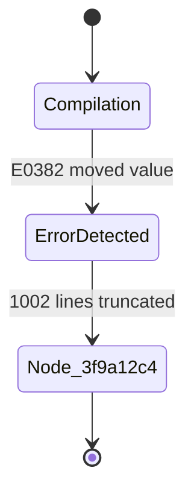

# FastMCP 协议规范与工具契约 (v1.0.0)

K0maru 原生内嵌了符合 Anthropic Model Context Protocol（FastMCP）标准的 JSON-RPC 2.0 服务端。当通过 `k0maru mcp` 启动时，它在标准输入输出流（stdio）上与智能体无缝通信，运行期间 0 驻留后台内存、0 常驻后台守护进程。

本手册详细规范 K0maru v1.0.0 的全量 8 大 MCP 原生工具、JSON Schema 契约、底层通讯报文以及专为 Oh My Pi 设计的正交伴生运行模式（`--sidecar`）。

---

## 🤖 运行模式：默认全量模式 vs. 正交 Sidecar 模式

K0maru 提供两种运行配置，以深度契合不同的智能体生态与终端环境：

| 特性 / 工具接口 | 默认全量模式 (Full Mode) | 正交伴生模式 (`--sidecar`) |
| :--- | :---: | :---: |
| **适配客户端** | Claude Code, Cursor, Windsurf, Hermes, OpenClaw, Gemini CLI | Oh My Pi (`omp`) |
| **暴露工具总数** | **8 大工具** | **5 大工具** |
| `get_project_loadout` | ✅ 启用 | ✅ 启用 |
| `recall_memory` | ✅ 启用 | ✅ 启用 |
| `guard_check` | ✅ 启用 | ✅ 启用 |
| `flush_session` | ✅ 启用 | ✅ 启用 |
| `distill_session_skill` | ✅ 启用 | ✅ 启用 |
| `offload_context` | ✅ 启用 | ❌ 屏蔽（`omp` 原生内置管道截断） |
| `inspect_log_node` | ✅ 启用 | ❌ 屏蔽（`omp` 原生内置日志透视） |
| `gc_session_context` | ✅ 启用 | ❌ 屏蔽（`omp` 原生内置会话压缩） |

> **为什么为 `omp` 定制 Sidecar 模式？**  
> Oh My Pi (`omp`) 原生具备出色的终端流截断与会话压缩能力。启用 `k0maru mcp --sidecar` 可避免工具功能重叠与模型注意力分散，专注于输出高密度的领域知识检索、决策结晶以及 $<10\text{ ms}$ 的 Living ADR 架构铁律守卫。

---

## 🛠️ 工具接口全景速查

| 原生工具名称 | 生效模式 | 核心职责 | 典型调用场景 |
| :--- | :--- | :--- | :--- |
| [`get_project_loadout`](#1-get-project-loadout) | 全量 & Sidecar | 提取项目愿景与 L3 铁律（<300 Token） | 智能体开辟新会话时进行背景对齐 |
| [`recall_memory`](#2-recall-memory) | 全量 & Sidecar | 多路混合检索（BM25 + 向量 + 图谱双链加权） | 编写核心逻辑或排查技术疑难时查阅知识库 |
| [`guard_check`](#3-guard-check) | 全量 & Sidecar | 审计 Git 变更是否违反 Living ADR 规则 (<10ms) | 提交代码前或完成重构后执行合规性检查 |
| [`flush_session`](#4-flush-session) | 全量 & Sidecar | 会话关键决策与架构心得原子结晶落盘 | 任务交付或完成重大架构决策后持久化 |
| [`distill_session_skill`](#5-distill-session-skill) | 全量 & Sidecar | 故障排障痕迹智能提炼为通用技能卡片 | 从失败回溯中提取自动化排障 Playbook |
| [`offload_context`](#6-offload-context) | 仅全量模式 | 终端长日志卸载为 Mermaid 状态图 (99.4% 压缩) | 运行测试或编译产生超长回溯时截断上下文 |
| [`inspect_log_node`](#7-inspect-log-node) | 仅全量模式 | 凭 Node ID 提取原始未截断日志切片 | 智能体需要精确定位某层具体报错调用栈 |
| [`gc_session_context`](#8-gc-session-context) | 仅全量模式 | 4 级长轨迹上下文垃圾回收（TRR $\ge 85\%$） | 多轮长对话历史精简与 Smart-Zone 维持 |

---

## 1. `get_project_loadout`
*生效模式：全量模式 & Sidecar 模式*

### 工具描述
提取目标项目的极简愿景概括、技术栈声明与 1-Hop 关联的核心 L3 架构不变量（约束在 `< 300 Token`），杜绝智能体注意力漂移与架构幻觉。支持变更感知的 Git diff 动态探测，自动激活与改动文件强相关的模块规则。

### JSON Schema 契约
```json
{
  "name": "get_project_loadout",
  "description": "Fetch high-priority architectural blueprint, core invariants, project vision, and recent ADR decision logs (<300 tokens) from the vault. Always call this at the start of any new coding session or before planning major changes. Supports change-aware diff inspection to dynamically activate module-relevant ADRs.",
  "inputSchema": {
    "type": "object",
    "properties": {
      "project_name": {
        "type": "string",
        "description": "Optional target project name or keyword. Auto-detected from repository/vault when omitted."
      },
      "diff": {
        "type": "boolean",
        "description": "Inspect Git changes in workspace and dynamically activate module-relevant ADRs (<300 tokens)."
      },
      "branch": {
        "type": "string",
        "description": "Optional base branch for comparison (e.g. 'main', 'dev')."
      }
    }
  }
}
```

### 调用输入示例
```json
{
  "project_name": "payment-gateway",
  "diff": true
}
```

### 返回值格式（Markdown）
```markdown
# Context Loadout: Payment Gateway Core
- Root: `10_Projects/payment-gateway.md`
- Core Stack: Go 1.22, Redis 7, PostgreSQL 16

## L3 Invariants & Decisions:
- [[adr-001-idempotency]]: 必须基于 `SET lock:payment:{event_id} "1" NX EX 30` 抢占分布式锁；事务内状态机校验 `STATUS_PENDING`。

## Recent L2 Logs:
- 2026-10-08: 修复 Stripe Webhook 重试风暴事故。
```

---

## 2. `recall_memory`
*生效模式：全量模式 & Sidecar 模式*

### 工具描述
使用 RRF 混合检索算法（FTS5 BM25 词法倒排 + 384 维稠密向量 + 1-Hop 图谱双向拓扑加权）召回知识库中的高相关笔记与历史决策。默认输出单行紧凑 K-DSL 格式（`!μ:...`）以极大节省智能体上下文，设置 `full: true` 可获取完整 Markdown 正文。

### JSON Schema 契约
```json
{
  "name": "recall_memory",
  "description": "Search and retrieve documentation, technical research reports, project context, past architectural decisions, configurations, setup guides, and notes from the user's local knowledge vault. Always call this tool first whenever the user asks for domain information or past decisions.",
  "inputSchema": {
    "type": "object",
    "properties": {
      "query": {
        "type": "string",
        "description": "Search query keywords or technical question."
      },
      "limit": {
        "type": "integer",
        "description": "Maximum number of results to return (default: 5)."
      },
      "full": {
        "type": "boolean",
        "description": "When true, returns full verbose markdown documents. When false (default), returns compact single-line K-DSL wire format (!μ:<tier>|<path>|score:<score>|links:<in>/<out> § <snippet>)."
      },
      "mode": {
        "type": "string",
        "enum": ["hybrid", "bm25", "vector"],
        "description": "Search mode (default: hybrid)."
      }
    },
    "required": ["query"]
  }
}
```

### 调用输入示例
```json
{
  "query": "Stripe webhook 幂等性 分布式锁",
  "limit": 3,
  "full": false
}
```

### 返回值格式（紧凑 K-DSL 格式）
```text
!μ:L3|20_Cards/adr-001-idempotency.md|score:0.082|links:3/5 § 必须基于 SET lock:payment:{id} NX EX 30 抢占分布式锁；事务内校验 STATUS_PENDING。
!μ:L2|30_Logs/2026-10-08-stripe-storm.md|score:0.041|links:1/2 § 修复并发重试风暴引发的级联重试雪崩事故。
```

---

## 3. `guard_check`
*生效模式：全量模式 & Sidecar 模式*

### 工具描述
在 $<10\text{ ms}$ 内审计 Git diff 或代码改动是否违反知识库中声明的 Living ADR 架构铁律。在提交代码或重构完成后调用，杜绝架构漂移。

### JSON Schema 契约
```json
{
  "name": "guard_check",
  "description": "Audit git diff or code changes against active Living ADR architectural invariants and project rules (<10ms). Always invoke this before committing or after implementing features to ensure mandatory patterns are satisfied.",
  "inputSchema": {
    "type": "object",
    "properties": {
      "diff": {
        "type": "string",
        "description": "Optional git unified diff text to audit. If omitted, automatically inspects working tree changes in current git repository."
      },
      "project_name": {
        "type": "string",
        "description": "Optional target project name to filter ADR invariants for."
      },
      "repo_path": {
        "type": "string",
        "description": "Optional path to the git repository to audit (defaults to current directory)."
      },
      "branch": {
        "type": "string",
        "description": "Optional base branch/revision for comparison (e.g. 'main', 'dev')."
      },
      "strict": {
        "type": "boolean",
        "description": "Treat advisory warnings as blocking failures."
      },
      "files": {
        "type": "array",
        "items": { "type": "string" },
        "description": "Optional explicit file paths to audit instead of a diff."
      }
    }
  }
}
```

### 调用输入示例
```json
{
  "diff": "diff --git a/src/db.rs b/src/db.rs\n+let res = sqlx::query(\"SELECT * FROM users\").fetch_all(&pool).await;",
  "strict": true
}
```

### 返回格式（审计报表）
```text
❌ Living ADR Guard Failure: 1 violation detected (<6ms)
- [ADR-008-QuerySafety] Line 1: 'SELECT * FROM users' 违反架构铁律 'deny: SELECT * FROM'.
  整改建议: 必须显式声明查询字段，严禁全表通配符扫描以杜绝潜在的数据泄露与索引失效。
  规则索引: [[20_Cards/adr-008-sql-best-practices.md]]
```

---

## 4. `flush_session`
*生效模式：全量模式 & Sidecar 模式*

### 工具描述
遵循知识库现有的目录组织形式与命名风格，自动生成标准 YAML Frontmatter 并将决策内容持久化落盘，自动编织关联笔记的 `[[WikiLinks]]`。支持通过 `supersedes` 显式废止陈旧规则，消解大语言模型的“信念固化”。

### JSON Schema 契约
```json
{
  "name": "flush_session",
  "description": "Crystallize technical decisions, verified bug fixes, architecture decisions (ADRs), or task milestones back into the local Markdown vault as permanent notes.",
  "inputSchema": {
    "type": "object",
    "properties": {
      "title": {
        "type": "string",
        "description": "Title of the decision or log note."
      },
      "content": {
        "type": "string",
        "description": "Detailed Markdown content."
      },
      "summary": {
        "type": "string",
        "description": "Brief one-line summary or executive conclusion."
      },
      "category": {
        "type": "string",
        "description": "Category: 'decision', 'log', 'concept' (alias: 'card'), 'skill', or custom (default: 'log')."
      },
      "tags": {
        "type": "array",
        "items": { "type": "string" },
        "description": "Associated tags (e.g. [\"redis\", \"mutex\"])."
      },
      "related_notes": {
        "type": "array",
        "items": { "type": "string" },
        "description": "Related existing notes to link via WikiLinks."
      },
      "supersedes": {
        "description": "Existing note(s) or ADR(s) that this note supersedes. Automatically marks old notes as status: superseded.",
        "oneOf": [
          { "type": "string" },
          { "type": "array", "items": { "type": "string" } }
        ]
      }
    },
    "required": ["title", "content"]
  }
}
```

### 调用输入示例
```json
{
  "title": "ADR-012: 分布式锁 Redlock 集群共识升级",
  "category": "decision",
  "summary": "从单实例 Redis 互斥迁移至 Redlock 集群以防主从切换脑裂",
  "supersedes": ["ADR-001-Redis-Mutex"],
  "tags": ["redis", "redlock", "consensus"],
  "related_notes": ["payment-gateway"],
  "content": "## 背景\n单实例 Redis 在 Master 切换时存在锁丢失竞争...\n## 架构铁律\n- deny: acquire_single_redis_mutex"
}
```

---

## 5. `distill_session_skill`
*生效模式：全量模式 & Sidecar 模式*

### 工具描述
从终端执行回溯、报错堆栈或已卸载的日志切片中自动提炼通用技能，并可选择直接导出至 Markdown 知识库、Nous Research Hermes Agent 或 Oh My Pi (`omp`) 技能生态。

### JSON Schema 契约
```json
{
  "name": "distill_session_skill",
  "description": "Distill an execution trace, compilation error, or debugging session into a reusable troubleshooting playbook/skill note and save it to the vault or export to Hermes Agent or omp.",
  "inputSchema": {
    "type": "object",
    "properties": {
      "raw_trace": {
        "type": "string",
        "description": "Raw execution log, error stack trace, or debugging terminal output."
      },
      "node_id": {
        "type": "string",
        "description": "Optional offloaded node ID from offload_context (e.g. node_1a2b3c4d)."
      },
      "title": {
        "type": "string",
        "description": "Optional explicit skill title (auto-inferred if omitted)."
      },
      "context_hint": {
        "type": "string",
        "description": "Optional context hint or explanation describing what happened."
      },
      "category": {
        "type": "string",
        "description": "Target category (defaults to 'skill')."
      },
      "tags": {
        "type": "array",
        "items": { "type": "string" },
        "description": "Optional tags array."
      },
      "related_notes": {
        "type": "array",
        "items": { "type": "string" },
        "description": "Optional related notes or WikiLinks array."
      },
      "dry_run": {
        "type": "boolean",
        "description": "If true, returns preview without writing to vault."
      },
      "target": {
        "type": "string",
        "enum": ["default", "hermes", "omp"],
        "description": "Optional target ecosystem schema: 'default' (vault), 'hermes' (Hermes skill), or 'omp' (omp skill)."
      }
    }
  }
}
```

---

## 6. `offload_context`
*生效模式：仅全量模式*

### 工具描述
截断并持久化超过 30 行的终端原始巨幅报错日志，返回高度凝练的 15 行 Mermaid 状态机图与唯一 `node_id`，防止上下文窗口被千行回溯污染。

### JSON Schema 契约
```json
{
  "name": "offload_context",
  "description": "Externalize and compress verbose terminal logs, build outputs, test traces, or error dumps (>30 lines) into a compact symbolic Mermaid state diagram on disk.",
  "inputSchema": {
    "type": "object",
    "properties": {
      "content": {
        "type": "string",
        "description": "The raw terminal output or stack trace to compress and store."
      },
      "task_id": {
        "type": "string",
        "description": "Optional task identifier prefix."
      }
    },
    "required": ["content"]
  }
}
```

### 返回值格式
```markdown


✓ Log offloaded (1002 lines, 99.4% token reduction)
  Reference ID: node_3f9a12c4
  Use 'inspect_log_node' to view raw stack frames.
```

---

## 7. `inspect_log_node`
*生效模式：仅全量模式*

### 工具描述
凭 Node ID 从本地离线切片存储池中提取未截断的局部原始日志。

### JSON Schema 契约
```json
{
  "name": "inspect_log_node",
  "description": "Retrieve and inspect the full offloaded raw terminal log or compiler trace content by its node ID (e.g. node_1a2b3c4d).",
  "inputSchema": {
    "type": "object",
    "properties": {
      "node_id": {
        "type": "string",
        "description": "The symbolic node identifier from the Mermaid state diagram."
      }
    },
    "required": ["node_id"]
  }
}
```

---

## 8. `gc_session_context`
*生效模式：仅全量模式*

### 工具描述
对多轮智能体长对话历史执行 4 级精简垃圾回收（Context GC），折叠高重复度的报错日志与工具回溯，将上下文维持在认知 Smart-Zone（15%–60%），实现 $\text{TRR} \ge 85\%$。

### JSON Schema 契约
```json
{
  "name": "gc_session_context",
  "description": "Perform long-trajectory context garbage collection (Context GC) on a multi-turn agent session trajectory, folding verbose tool outputs and repetitive compiler error dumps into symbolic references to keep context within the cognitive Smart-Zone (15%-60%) with TRR >= 85%.",
  "inputSchema": {
    "type": "object",
    "properties": {
      "trajectory_json": {
        "type": "string",
        "description": "JSON serialized SessionTrajectory containing session_id and turns array."
      },
      "threshold": {
        "type": "integer",
        "description": "Line threshold before tool output is folded (default: 20)."
      },
      "hot_window": {
        "type": "integer",
        "description": "Number of recent turns preserved untouched in hot window (default: 5)."
      },
      "context_window": {
        "type": "integer",
        "description": "Context window size in tokens for Smart-Zone evaluation (default: 128000)."
      }
    },
    "required": ["trajectory_json"]
  }
}
```
