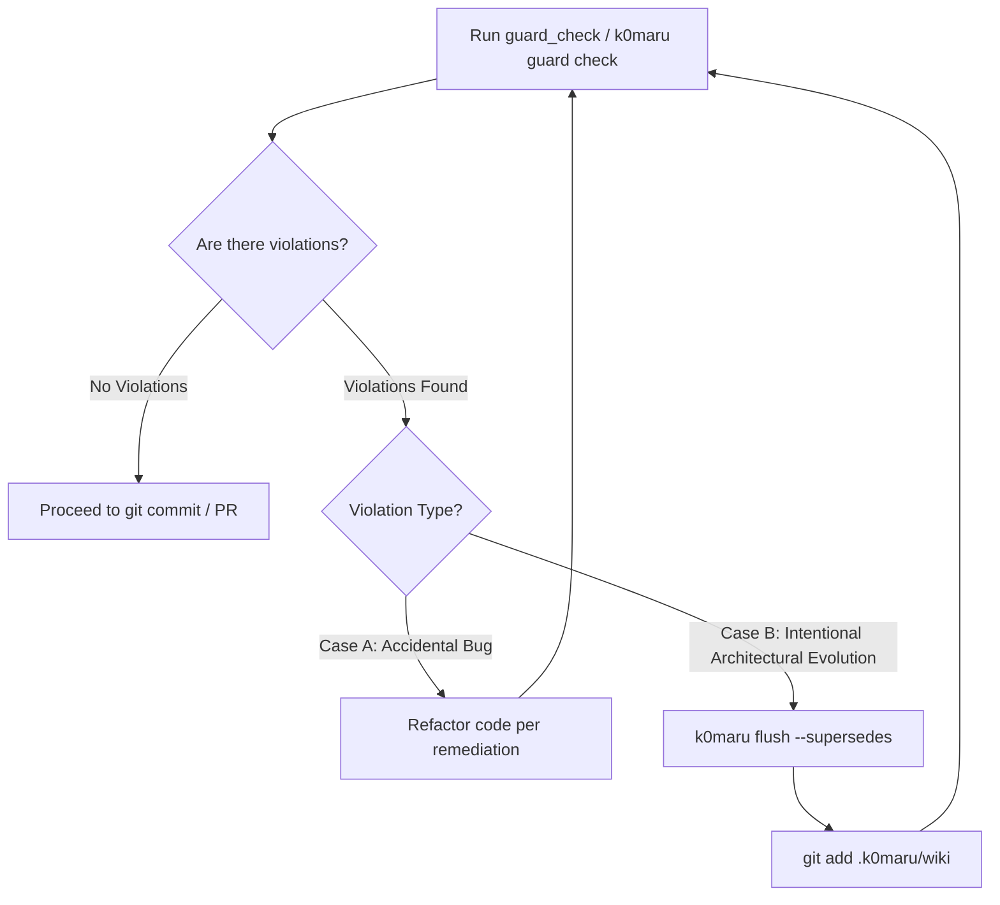

# k0maru-guard (Living ADR Guard & Invariant Sentinel)

A sub-10ms architectural sentinel that evaluates code changes against active Architecture Decision Records (ADRs), project invariants, and safety boundaries stored in your knowledge vault (any LLM-Wiki / Obsidian vault) or repository config.

---

## 🎯 When to Use

1. **Before Git Commit**: Validate that staged or unstaged changes do not introduce forbidden patterns or violate architectural rules.
2. **During Subagent Implementation (`/implement`)**: Implementor subagents must verify compliance against active ADRs before reporting work complete.
3. **During Code Review (`/code-review`)**: Reviewers run invariant checks as part of the formal Dual-Axis Audit (Standards & Smells vs ADR Invariants).
4. **Repository Onboarding (`/init-agents`)**: Inject the pre-commit hook into `.git/hooks/` to permanently guard against architecture decay.

---

## 🚀 Execution Seams

### Seam 1: Native FastMCP Tool (`guard_check`)
When operating as an AI Agent connected via MCP, call `guard_check`:

```json
// Auto-inspect working tree git diff for current repository:
guard_check({})

// Filter invariants for a specific project:
guard_check({ "project_name": "k0maru-agent-memory" })

// Audit explicit diff text:
guard_check({ "diff": "diff --git a/src/api.rs ...", "project_name": "payment-gateway" })
```

### Seam 2: CLI Command (`k0maru guard check`)
When executing commands in the terminal:

```bash
# 1. Audit current working tree / index git diff (default, <5ms)
k0maru guard check --diff

# 2. Audit against a specific project's ADRs
k0maru guard check --project <project_slug>

# 3. Audit specific files directly
k0maru guard check src/storage/db.rs src/api/handlers.rs

# 4. Strict mode (warnings treated as blocking exit code 1)
k0maru guard check --strict

# 5. Output structured JSON (ideal for CI/CD pipelines)
k0maru guard check --json
```

**POSIX Exit Codes**:
- `0`: All architectural invariants passed.
- `1`: Blocking violation (`severity = "deny"`) detected.
- `2`: Blocking violation in `--claude-stop-hook` mode (feeds `[AGENT_SELF_HEAL_PROTOCOL]` to stderr so the agent self-heals before yielding), or CLI argument/usage error.

### Seam 3: Git Pre-Commit Hook Installation
Install the sub-5ms pre-commit sentinel directly into the repository:

```bash
k0maru guard install
```
*Note: The installer is non-destructive and idempotent; it chains safely with existing hooks (Husky, pre-commit).*

---

## 📐 Declaring Living ADR Invariants

Invariants are extracted directly from your knowledge base (LLM-Wiki) or repository config:

### Format A: Markdown List Syntax (Recommended for Notes & ADR Bodies)
Add an `Invariants` section directly to any Markdown note or ADR:

```markdown
## Non-Negotiable Invariants

- [no-raw-sql-in-controllers] (deny) [src/api/**/*.rs] forbidden: "SELECT " | remediation: "Delegate database operations to repository traits in src/storage/."
- [must-use-fenced-lease] (deny) [src/settlement/**/*.rs] must_contain: "acquire_fenced_lease" | remediation: "All settlement methods must acquire a distributed fenced lease."
- [must-propagate-result] (deny) [crates/**/*.rs] forbidden: ".unwrap()" | remediation: "Use ? operator or map_err to propagate custom errors."
```

**Format**: `- [<id>] (<severity>) [<path_glob>] <forbidden|must_contain>: "<pattern>" | remediation: "<fix_hint>"`

### Format B: YAML Frontmatter in ADR / Project Notes
Add an `invariants` block to the frontmatter of any markdown card or ADR:

```yaml
---
title: ADR-008 Storage Layer Decoupling
date: 2026-10-12
status: accepted
invariants:
  - id: "no-raw-sql-in-controllers"
    description: "Controllers and services must not execute raw SQL queries"
    scope: ["src/api/**/*.rs", "src/services/**/*.rs"]
    condition:
      forbidden: ["SELECT ", "INSERT INTO ", "UPDATE ", "DELETE FROM "]
    severity: "deny"
    fix_hint: "Delegate database operations to repository traits in src/storage/."
  - id: "must-propagate-result"
    description: "Library code must not call unwrap() in production paths"
    scope: ["crates/**/*.rs"]
    condition:
      forbidden: [".unwrap()"]
    severity: "deny"
    fix_hint: "Use ? operator or map_err to propagate custom errors."
---
```

### Format C: Local Repository Fallback (`.k0maru/rules` or `.k0maru/guard.toml`)
For standalone repositories without an active vault mount:

```toml
[[rules]]
id = "SEC-001"
title = "No hardcoded credentials"
file_pattern = "src/**/*.rs"
severity = "deny"
forbidden = "DANGEROUS_SECRET_KEY"
remediation = "Use std::env::var or secret manager."
```
---

## 🛠️ Violation Triage & Auto-Remediation Workflow

When `guard_check` or `k0maru guard check` returns violations:



### Case A: Accidental Violation (Code Refactoring)
1. **Never bypass a `deny` violation** by using `--no-verify` or ignoring the output.
2. Read the `remediation` / `fix_hint` and inspect the flagged file and line numbers.
3. Refactor the diff so that forbidden patterns are removed or mandatory constraints are met.
4. Re-run `k0maru guard check --diff` until the sentinel gives green: `✅ Ready to commit`.

### Case B: Legitimate Architectural Evolution (Superseding Stale ADR)
When the human developer explicitly asks to replace or evolve an older architectural decision:
1. Do **NOT** delete the guard rule or bypass Git hooks.
2. Supersede the obsolete ADR using `k0maru flush --supersedes`:
   ```bash
   k0maru flush \
     --category decision \
     --title "ADR-042: Fenced Distributed Token Lease Standard" \
     --supersedes "ADR-010: Legacy Redis SetNX Lock" \
     --summary "Migrated settlement locking to distributed fenced token leases" \
     --content $'## Non-Negotiable Invariants\n- [fenced-lease-required] (deny) [src/settlement/**/*] must_contain: "acquire_fenced_lease" | remediation: "Use acquire_fenced_lease() for all settlement flows."'
   ```
3. Stage the updated knowledge base alongside code changes: `git add .k0maru/wiki`
4. Re-run `k0maru guard check --diff`. The old invariant is automatically retired and the new invariant takes effect.
